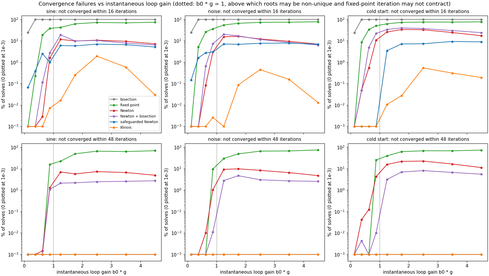
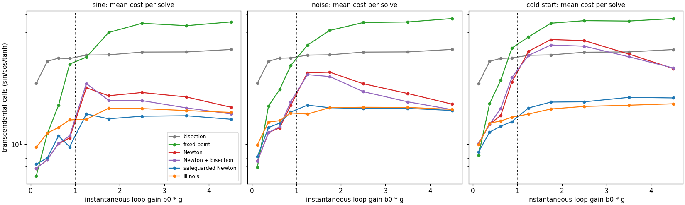
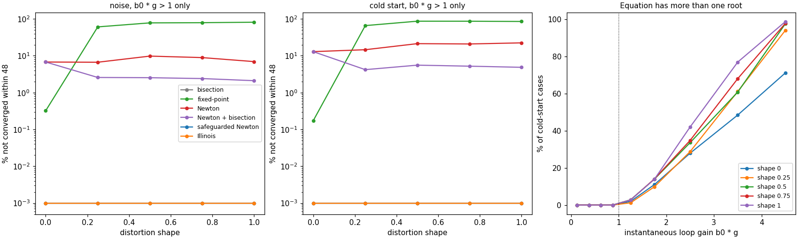

# Root-finding methods for the FilterDistort delay-free loop

Generated by `analysis/root_finding_comparison.py`; every number here can be reproduced by running it
(about 2 minutes). The raw tables are in this folder (`summary_*.csv`, `breakdown.csv`,
`root_multiplicity.csv`, `root_choice.csv`).

## The problem

Each sample, the module must solve

$$
h(y) = y - b_0\,\bigl(x + g\,D(y)\bigr) - s = 0,
\qquad
D(y) = 5\,\mathrm{distort}(0.2\,y,\ \mathrm{shape})
$$

for the filter output $y$. Here $x$ is the input sample, $b_0$ is the biquad's instantaneous coefficient,
$s$ its stored-state contribution and $g$ the feedback gain. All arithmetic is float32, matching the module.
The tolerance is the module's $10^{-5}$.

Two properties of this equation drive almost all of the results:

1. **The instantaneous loop gain $\kappa = b_0 g$.** Since $\lvert D'\rvert \le 1$ for every shape,

   $$h'(y) = 1 - \kappa\,D'(y) > 0 \quad \text{when } \kappa < 1.$$

   So for $\kappa < 1$ there is exactly one root, and fixed-point iteration is a contraction (Avanzini et al.
   2005, eq. 12–14). Above $\kappa = 1$ the equation can have several roots: up to 5 were found here.
2. **An a-priori bracket.** Since $\lvert D\rvert \le 5$, every root lies in

   $$c - 5\kappa \;\le\; y \;\le\; c + 5\kappa, \qquad c = b_0 x + s,$$

   with $h \le 0$ at the lower end and $h \ge 0$ at the upper end. Bracketing methods therefore never need to
   search for a sign change, and are guaranteed to converge. This held in 100% of 200,000 random test cases.

$\kappa$ is set mainly by mode, cutoff and gain:

- **Lowpass:** $b_0 \to 0$ at low cutoff, so $\kappa$ is only large at high cutoff.
- **Highpass:** $b_0 \to 1$ at low cutoff, so $\kappa \approx g$. Highpass is therefore the hardest mode.
- **Q:** only a small effect.

In this grid $\kappa$ ranges from about 0 to 5, and about 24% of parameter combinations have $\kappa > 1$.

## Methods

| Method | Description | Uses initial guess | Cost per iteration* |
|---|---|---|---|
| bisection | binary search on the a-priori bracket | no | 2 |
| fixed-point | Avanzini et al. (2005) fig. 3(b), as `solveFixedPoint()` | yes | 2 |
| Newton | plain Newton–Raphson, as `solveDelayFree()` | yes | 3 |
| Newton + bisection | `newton_bisection.py`: bisect once a step leaves a bracket it has found | yes | ≤ 3 |
| safeguarded Newton | Newton inside the a-priori bracket, bisecting whenever a step would leave it or isn't shrinking fast enough (Numerical Recipes' `rtsafe`) | yes | 3 |
| Illinois | modified regula falsi on the a-priori bracket, after one evaluation at the initial guess | yes | 2 |

\*Cost per iteration counts transcendental function calls ($\sin$, $\cos$, $\tanh$): $D$ takes $\sin$ and
$\tanh$, and $D'$ takes $\cos$ and $\tanh$, with $\tanh$ shared. This is a proxy for CPU cost; no C++
benchmark was run. "Newton + bisection" is counted at 3 per iteration, which is an upper bound, because its
bisection steps don't need $D'$.

## Experiments

The test grid: 3 modes × 10 cutoffs (50 Hz–20 kHz) × $Q \in \{0.707, 2, 8\}$ ×
$g \in \{0.5, 1, 2, 3, 4, 5\}$ × shape $\in \{0, 0.25, 0.5, 0.75, 1\}$. That's 2,700 module instances at
48 kHz.

- **sine:** the module running on a 5 V, 110 Hz sine for 2 periods. The initial guess is the previous
  output.
- **noise:** the module running on uniform white noise in ±5 V. This is a harder input because the
  previous output is a worse guess.
- **cold start:** 400 single solves per instance, with the initial guess $y_0$ and the known term $c$ each
  uniform in $[-20, 20]$ V. This measures robustness when the guess is poor.

Every method had a budget of 48 iterations. "Within 16" is read from the same runs, and shows what each
method would achieve under the module's current `NR_MAX_ITERATIONS`.

## Results

### Overall (all 2,700 instances)

| Method | sine: conv. ≤16 / ≤48 | noise: conv. ≤16 / ≤48 | cold: conv. ≤16 / ≤48 | mean iterations (sine / noise / cold) | mean cost (sine / noise / cold) | p99 / max iterations (noise) |
|---|---|---|---|---|---|---|
| bisection | 42.3% / **100%** | 42.1% / **100%** | 42.6% / **100%** | 16.5 / 16.6 / 16.5 | 33 / 33 / 33 | 23 / 23 |
| fixed-point | 81.0% / 85.1% | 79.3% / 84.8% | 77.0% / 82.6% | 11.5 / 12.5 / 13.8 | 23 / 25 / 28 | 48 / 47 |
| Newton | 97.5% / 98.4% | 96.9% / 98.0% | 92.6% / 95.3% | 3.6 / 4.5 / 6.9 | 11 / 13 / 21 | 48 / 47 |
| Newton + bisection | 97.4% / 99.3% | 96.6% / 99.2% | 90.2% / 98.4% | 3.5 / 4.3 / 6.7 | ≤10 / ≤13 / ≤20 | 41 / 47 |
| safeguarded Newton | 98.3% / **100%** | 97.7% / **100%** | 98.2% / **100%** | **3.2 / 3.9 / 4.1** | **9.6 / 11.8 / 12.4** | 21 / 30 |
| Illinois | **99.8% / 100%** | **99.96% / 100%** | **99.9% / 100%** | 6.0 / 6.4 / 6.4 | 12 / 13 / 13 | **12 / 25** |

### Convergence vs loop gain

- **Below $\kappa \approx 0.75$, everything converges.** The one exception is plain Newton, which rarely
  fails from cold starts (≤ 0.1%), even though the root is unique there. It can overshoot across the
  inflection of $h$ and cycle.
- **Fixed-point** slows sharply as $\kappa \to 1$, because its error shrinks by about a factor of $\kappa$
  per iteration, so it needs roughly

  $$n \approx \frac{\log \varepsilon}{\log \kappa}$$

  iterations for tolerance $\varepsilon$. It already fails about 10–25% of solves in the 0.75–1 bin. Above
  1 it fails 25–70%.
- **Newton and Newton + bisection** fail about 5–23% and 2–8% respectively above $\kappa = 1$, depending
  on the experiment.
- **Bisection, safeguarded Newton and Illinois** never fail with 48 iterations. Under a 16-iteration
  budget:
  - bisection usually runs out, since it needs $\log_2\!\bigl(10\kappa / 10^{-5}\bigr) \approx$ 17–23
    steps.
  - safeguarded Newton runs out in about 3–10% of $\kappa > 1$ solves.
  - Illinois runs out in at most about 2%.

### Cost

- **Safeguarded Newton** has the lowest mean cost overall. It's cheaper than plain Newton even where both
  converge, because it stops once the bracket is narrower than the tolerance and replaces wild steps with
  bisection.
- **Illinois** costs about the same on average, and has the tightest worst case (p99 of 12–13
  iterations).
- **Bisection** is the most predictable, at about 22 iterations, but always the most expensive except for
  fixed-point at high $\kappa$.

### Shape, mode and Q

- **Shape matters a lot for fixed-point.**
  - With shape 0 (pure $\tanh$), $D$ is increasing. Fixed-point iteration of an increasing, bounded map is
    monotone and always converges, even for $\kappa > 1$: only 0.2–0.3% fail to converge within 48
    iterations.
  - Any sine blend makes $D$ non-monotone. Fixed-point then oscillates or wanders: 60–85% of
    $\kappa > 1$ solves fail.
- **Shape matters for Newton + bisection.** For shape 0 it is no better than plain Newton. With $\tanh$,
  Newton's failures are cycles on one side of a root that never produce a sign change, so it never finds
  a bracket to search. This is case (g) in `newton_bisection.png`.
- **Mode:** highpass dominates the failures for every method that can fail, because it has the largest
  $\kappa$. For example, on the noise input fixed-point fails 37.7% for highpass against 6.1% for lowpass,
  and Newton 5.2% against 0.24%.
- **Q:** has almost no effect at a given mode, cutoff and gain (`breakdown.csv`).

### Multiple roots and which one gets picked

Fraction of cold-start cases with more than one root:

| $\kappa$ | ≤ 1 | 1–1.5 | 1.5–2 | 2–3 | 3–4 | 4–5 |
|---|---|---|---|---|---|---|
| more than one root | 0% | 2.3% | 12.5% | 33.4% | 63.1% | 91.9% |

When there are several roots, the method decides which one the module outputs. The table below covers the
sine input with $\kappa > 1$, comparing each method's choice with the root nearest the previous output:

| Method | samples with several roots | of those, picked a root other than the nearest |
|---|---|---|
| Newton + bisection | 55.1% | **0.8%** |
| Newton | 57.2% | 1.7% |
| safeguarded Newton | 57.8% | 4.7% |
| fixed-point | 55.5% (among converged samples) | 9.5% |
| Illinois | 61.4% | 29.7% |
| bisection | 72.4% | 57.0% |

Picking the root nearest the previous output gives continuous, hysteretic behaviour, like a Schmitt
trigger. Jumping between roots gives a discontinuity in the output.

- **Warm-started Newton variants** almost always stay on the nearest root.
- **Illinois** often lands on a different root, because false-position steps follow the bracket, not
  the guess.
- **Bisection** effectively picks a root at random.

So with $\kappa > 1$, the choice of method changes the sound, not just the CPU cost.

Even so, the $\kappa > 1$ regime is discontinuous with every method. On the sine input, output jumps of
more than 2 V happened thousands of times per second for all six methods (from the exploratory run; not in
the script). The delay-free positive feedback loop is itself hysteretic or chaotic there.

## Conclusions

1. **$\kappa = b_0 g < 1$ is the dividing line.** Below it the root is unique and every method works.
   Fixed-point works too, though it slows near 1. Above it there can be several roots, fixed-point usually
   fails for sine-blend shapes, and plain Newton fails in about 5–23% of solves.
2. **Safeguarded Newton is the best general choice for the module.**
   - It converged in 100% of about 5.8 million solves.
   - It has the lowest mean cost in every experiment (about 3–4 iterations).
   - Its worst case was 30 iterations, with p99 ≈ 20.
   - It mostly keeps the continuous root (95%).
   - It's a small change to `solveDelayFree()`: compute the bracket $c \pm 5\lvert b_0 g\rvert$, update it
     from the sign of $h$ each iteration, and bisect when the Newton step would leave the bracket.
3. **Illinois** suits a strict per-sample CPU budget (p99 of 12–13 iterations, 99.9% within 16, no
   derivative needed). The cost is more root-jumping when $\kappa > 1$.
4. **The current 16-iteration budget** is too small for bisection, and slightly too small for safeguarded
   Newton when $\kappa > 1$ (about 2% of solves overall need more). About 24 iterations covers safeguarded
   Newton's p99 with margin.
5. **Fixed-point (Avanzini et al.)** is only dependable for $\kappa$ well below 1, or for shape 0.

## Caveats

- **Cost** is a transcendental-call proxy. Real cost also depends on branches, and on SIMD if the module
  is ever made polyphonic.
- **"Nearest root to the previous output"** is a continuity criterion, not a claim about which root is
  physically correct.
- **Parameter sampling:** cold-start $y_0$ and $c$ are uniform in $[-20, 20]$ V, and the grid samples
  parameters coarsely (10 cutoffs, 6 gains). Percentages are per solve across that grid, not weighted by
  how the module is likely to be used.
- **Failure handling:** when a solver fails, the module simulation falls back to its estimate (or to the
  naive loop if that isn't finite), as the module does. So the methods' trajectories diverge after their
  first difference.
- **Fixed-point** is iterated on the nonlinearity's output $y_N$, as in the module. Its result is mapped
  back to $y = c + b_0 g\, y_N$.
