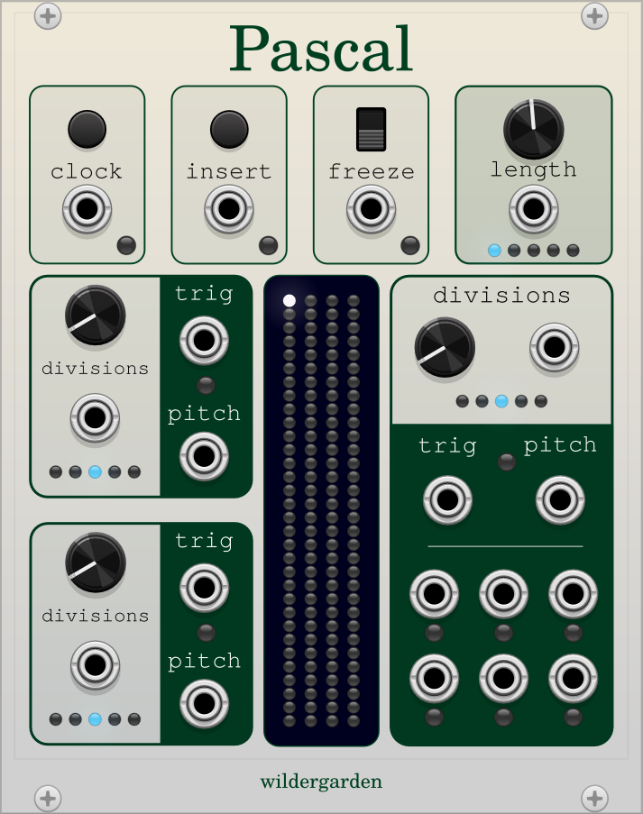
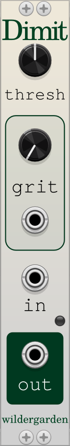
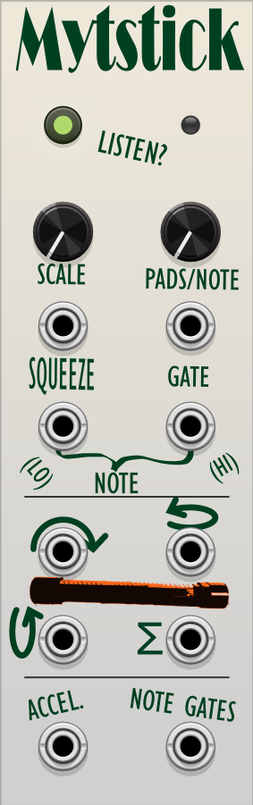

# Wildergarden plugin for VCV Rack

## Pascal

This plugin uses Pascal's triangle, a mathematical pattern independently invented throughout the world during the Middle
Ages, to create evolving melodies and drum sequences.

The light grid down the middle of the interface shows the current rows of the triangle as they are computed. (The rows
are turned vertically to save space.) As a row is computed, the $n$th spot is set to the sum of the $n$th and $n-1$th
items in the previous row. Rather than grow forever, these numbers are looped around, modulo the moduli of the output
units.

### Main Inputs

The computation and output of a row steps every time the **clock** input goes low. If an input is received to the 
**insert**, the currently selected number is set to 1.

Once the counter reaches the end of a row, it advances to the next row, using the row that was just computed to compute
the next row, unless there is **freeze** input, in which case it will stay on the current row.

The maximum row length is set by the **length** input. Anything past that length is set to zero, so setting a short
length can be a good way to clear the grid.

### Output Sectors

Pascal has three output sectors, which send out triggers and pitch for the current spot on the row. The **divisions**
input sets the modulus for that particular output sector. Every time the current row item is nonzero modulo that number,
the **trigger** will output and the pitch will be set to the row item mod that modulus. The pitch values range between
0 and 5V, and are not quantized to a scale.

The third output sector has six additional trigger outputs that trigger on the first six nonzero modulo values. This is
useful for programming a pattern across multiple drums.

## Dimit

Dimit is a combined compressor and waveshaper, designed to tame peaks in an audio signal. The **threshold** input sets a
voltage above which peaks are tamed. The **grit** input sets how quickly it resolves the signal above that voltage: 
higher grit means quicker response, and more harmonic distortion. **In** and **out** are for the audio signal to be
compressed or distorted.

## Mytstick

Mytstick is an interface for the [T-Stick](https://www.idmil.org/project/the-t-stick/), a digital musical instrument
that sends its sensor data over OSC. It listens for the T-Stick's messages and turns squeeze, touch and rotation into
control voltages.

### Connection

The **listen** button turns OSC listening on and off, and is lit while listening. The **RX** light flashes whenever a
recognised message arrives, which is a quick way to check that the T-Stick is reaching the module.

By default, Mytstick listens on all network interfaces (IP `0.0.0.0`) on port `8000`. To change either, right-click
the module and edit **Listen IP** or **Listen port**, then press Enter to apply. The context menu also shows the current
connection status, such as "Listening on 0.0.0.0:8000" or an error if the port couldn't be opened. The IP and port are
saved with the patch.

### Squeeze and Touch

**Squeeze** outputs how hard the force-sensing resistor is being pressed, from 0V to 10V.

**Gate** is 10V while any touchpad is touched, and 0V otherwise. Note that touching the force-sensing resistor on the
back of the T-Stick does not trigger the gate.

The T-Stick's surface is divided into a row of touchpads. **Touch lo** and **touch hi** output the lowest and highest
touched pads as 1V/oct pitches, so touching two places on the stick gives two notes. The **scale** knob selects the
scale the pads are mapped to: major, minor, major pentatonic, minor pentatonic or chromatic. The lowest pad is 0V, and
each pad going up the stick is the next note in the scale. When the stick is let go, these outputs hold their last notes.

The idea behind these outputs is to make playing the T-Stick feel like playing a stringed instrument like a guitar or
violin, since on those instruments, the highest finger touching the string controls the pitch, and touching
the string behind that finger does nothing.

The **group** knob sets how many neighbouring pads share a note, from 1 to 5. With a group of 2, the first two pads
play the root, the next two the second scale degree, and so on. Larger groups give bigger, easier-to-hit targets for
each note.

**Notes** is a polyphonic output with one gate channel per note (up to 16 channels). Each channel is 10V while any pad
in that note's group is touched. I've been using this output as a way to play chords by mapping each group to a different
note in the scale in a weighted quantizer, then feeding an arpeggio into the quantizer. 

### Rotation

The rotation outputs measure how far the stick has turned since it was last touched. Each time the touch gate goes high,
the current position becomes the new zero point, so a performer can grab the stick and then tilt or twist it to sweep a
control from 0V.

**Pitch**, **yaw** and **roll** output the change in each angle, at 1V per quarter turn ($\pi/2$ radians). These are
unwrapped, so turning the stick past a half turn keeps counting smoothly instead of jumping from $+\pi$ to $-\pi$.

**Total** outputs how far the stick's orientation is from where it was when touched, in any direction. It is 0V at the
start and 10V when the stick has been turned all the way around (a half turn, the furthest it can be from where it
started).

### Acceleration

**Accel** outputs the total acceleration of the stick, at 1V per $g$. It is offset by 1V so that it sits near 0V when the
stick is held still, and rises when the stick is shaken or swung. A jab will register as a spike in acceleration.

The squeeze, rotation and acceleration outputs are smoothed slightly, so they move between OSC messages without
stepping. The gate and pitch outputs change instantly.
